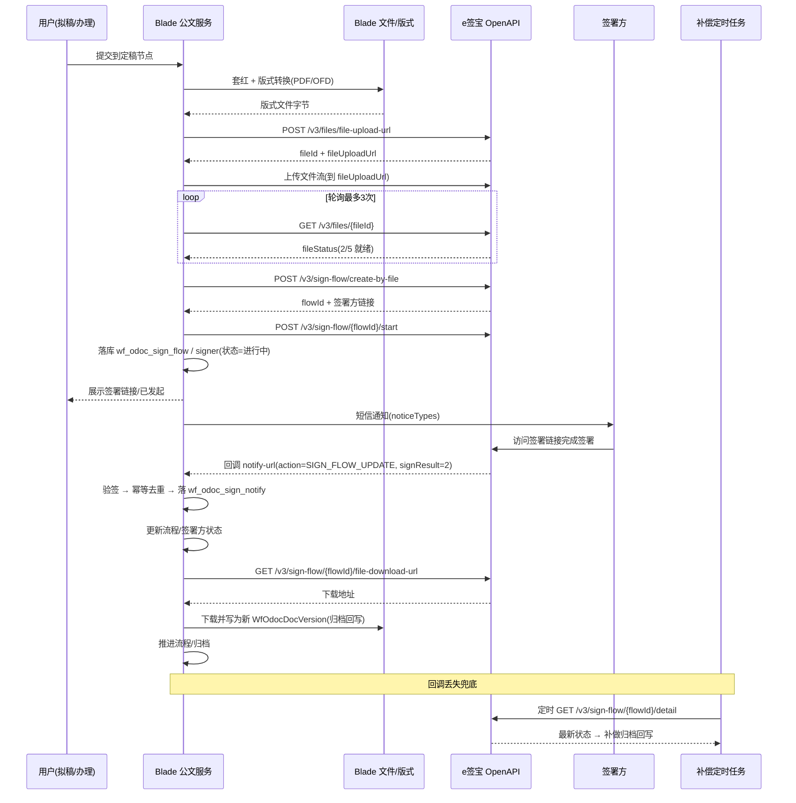

# e签宝电子签章 × Blade 公文流程 集成技术方案

> **版本**：v1（草稿）
> **日期**：2026-10-25
> **接口基准**：e签宝 **SaaS API V3**（依据官方 Demo `SaaSAPI_V3_Demo_JAVA` 源码核实）
> **目标模块**：`blade-service/blade-workflow` → `odoc`（公文）子域
> **⚠️ 重要**：本文 DDL 为**设计草稿**；实际落地时须按项目规范在 `doc/sql/migration/` 下建**独立迁移文件**，**禁止直接改 `blade.sql`**。

### 落地进度（2026-10-25）

| 阶段 | 状态 | 产出 |
|---|---|---|
| ① 建表 | ✅ 已完成 | `V2026.10.25_001__wf_odoc_esign.sql`、`V2026.10.25_002__wf_odoc_esign_base_cols.sql`（已在 dev 库 `blade` 执行） |
| ② 实体/Mapper | ✅ 已完成 | `odoc/entity/WfOdocSignFlow`、`WfOdocSignSigner`、`WfOdocSignNotify` + 对应 `odoc/mapper/*Mapper` |
| ③ 接口与配置 | ✅ 已完成 | `odoc/esign/IEsignService`、`esign/impl/EsignServiceImpl`、`esign/core/EsignSigner`（签名）、`EsignHttpExecutor`（HTTP）、`esign/config/EsignProperties`、`esign/dto/*` |
| ④ 印章策略（D2 并存） | ✅ 已完成 | `odoc/seal/IOdocSealStrategy` + `OdocSealCmd/OdocSealSignerCmd/OdocSealOption/OdocSealOutcome` + `OdocSealStrategyHolder` + `impl/LocalSealStrategy` + `impl/EsignSealStrategy` |
| ④.1 签章方案页面配置 | ✅ 已完成 | 前端 `/odoc/setting` 新增「电子签章方案」区块；后端 `/odoc/setting/seal`；迁移 `V2026.10.25_003`；方案选择落业务表 `wf_odoc_setting.seal_mode`（见 §4.2） |
| ⑤ 回调与补偿 | ✅ 已完成 | `POST /odoc/esign/callback`（验签 → 幂等落库 → 以厂商详情同步状态 → 归档回写）+ `EsignCompensateJob` 补偿任务 + `GET /odoc/esign/sign-url/{id}`（见 §6.4；**需发布 Nacos 的 `xss.skip-url`/`secure.skip-url` 白名单**） |
| ⑥ 流程接线 | ✅ 已完成 | `odoc/sign/WfOdocSignAssignListener`（提交后置块发起用印）+ `OdocSealConfigItem`（`seal_config` JSON）+ `WfNodeMustDoActionExecutor` 提交前校验按方案分流 + `GET /odoc/esign/status`（见 §4.3） |
| ⑦ 前端配套 | ✅ 已完成 | `/odoc/setting` 签章方案卡片、流程设置弹窗「用印位置与签署方」、公文区第三方签署状态与「去签署」（见 §4.4） |
| ⑧ 编译与单测验证 | ✅ 已完成 | 全量 38 个模块 `mvn -o package` BUILD SUCCESS；odoc 包 101 个用例全绿（新增 `EsignSignerTest`、`OdocSealConfigItemTest`）；前端 `tsc --noEmit` 无本次改动相关报错 |
| ⑨ 签完才流转（回调再推进） | ✅ 已完成 | `odoc/sign/OdocSealAdvancer`（CAS 幂等推进）+ `EsignFlowService.compensateAdvance`（已签署未推进的补偿重试）+ 拒签/超时 `terminate` 恢复待办；迁移 `V2026.10.25_004` |
| ⑩ 沙箱联调与健壮性加固 | ✅ 已完成（端到端待真实凭据） | `doc/esign/esign_sandbox_test.py`（连通性/回调/印章/全链路 4 模式）；回调幂等两档语义 + 厂商错误显式化；新增 `EsignFlowServiceTest`、`EsignServiceImplTest`（9 用例全绿） |

---

## 目录

- [1. 接口能力清单（已核实）](#1-接口能力清单已核实)
- [2. 接入方式](#2-接入方式)
- [3. 表结构 DDL 草稿](#3-表结构-ddl-草稿)
- [4. IEsignService 接口定义](#4-iesignservice-接口定义)
- [5. Nacos 配置树](#5-nacos-配置树)
- [6. 回调设计与时序图](#6-回调设计与时序图)
- [7. 五环节对接要求](#7-五环节对接要求)
- [8. 待确认事项清单（C）](#8-待确认事项清单c)

---

## 1. 接口能力清单（已核实）

> 来源：`SaaSAPI_V3_Demo_JAVA/src` 各模块 Demo 中的 `apiaddr` 常量，**为真实路径**（此前官网文档为 JS 渲染无法抓取，此处由源码补齐）。

### 1.1 文件与模板（`fileAndTemplate`）

| 接口 | 方法 | 用途 |
| --- | --- | --- |
| `/v3/files/file-upload-url` | POST | 获取文件 ID + 上传地址（入参：`contentMd5`、`fileName`、`fileSize`、`convertToPDF`、`contentType`） |
| （返回的 `fileUploadUrl`） | PUT/POST 流 | 上传文件二进制 |
| `/v3/files/{fileId}` | GET | 查询文件状态；**`fileStatus` 为 `2` 或 `5` 才算准备完成** |
| `/v3/doc-templates/doc-template-create-url` | POST | 创建模板 |
| `/v3/doc-templates/{docTemplateId}/doc-template-edit-url` | POST | 编辑模板 |
| `/v3/doc-templates/{docTemplateId}` | GET | 模板详情 |

> **关键**：文件上传是**三步走**（取地址 → 传流 → **轮询状态**），且官方 Demo 明确注释"文件有一个异步处理过程，建议轮询文件状态，正常后发起签署"。

### 1.2 签署服务（`sign`）★核心

| 接口 | 方法 | 用途 |
| --- | --- | --- |
| `/v3/sign-flow/create-by-file` | POST | **基于文件创建签署流程** |
| `/v3/sign-flow/{signFlowId}/start` | POST | 发起签署 |
| `/v3/sign-flow/{signFlowId}/finish` | POST | 结束签署流程 |
| `/v3/sign-flow/{signFlowId}/revoke` | POST | 撤销 |
| `/v3/sign-flow/{signFlowId}/detail` | GET | 流程详情（**补偿查询用**） |
| `/v3/sign-flow/sign-flow-list` | GET | 流程列表 |
| `/v3/sign-flow/{signFlowId}/sign-url` | POST | 获取签署链接 |
| `/v3/sign-flow/batch-sign-url` | POST | 批量获取签署链接 |
| `/v3/sign-flow/{signFlowId}/file-download-url` | GET | **下载签署件（归档回写用）** |
| `/v3/sign-flow/{signFlowId}/urge` | POST | 催办 |
| `/v3/sign-flow/{signFlowId}/delay` | POST | 延期 |
| `/v3/sign-flow/{signFlowId}/copiers` | POST | 添加抄送方 |
| `/v3/sign-flow/{signFlowId}/copiers/delete` | DELETE | 删除抄送方 |
| `/v3/sign-flow/{signFlowId}/attachments` | POST | 添加附件 |
| `/v3/sign-flow/{signFlowId}/attachments?fileIds=` | DELETE | 删除附件 |
| `/v3/sign-flow/{signFlowId}/unsigned-files` | GET/POST | 未签署文件 |
| `/v3/sign-flow/{signFlowId}/signers/sign-fields` | POST | 添加签署方签署区 |
| `/v3/sign-flow/{signFlowId}/signers/sign-fields?signFieldIds=` | DELETE | 删除签署区 |
| `/v3/sign-flow/{signFlowId}/rescission-url` | GET | 撤销链接 |

**`create-by-file` 请求体结构（核实）**

```json
{
  "docs": [{ "fileId": "...", "fileName": "xxx.pdf" }],
  "signFlowConfig": {
    "signFlowTitle": "标题",
    "chargeConfig": { "chargeMode": 0 }
  },
  "signers": [{
    "noticeConfig": { "noticeTypes": "1" },
    "orgSignerInfo": {
      "orgId": "",
      "orgName": "**公司",
      "orgInfo": {
        "orgIDCardNum": "915...", "orgIDCardType": "CRED_ORG_USCC",
        "legalRepName": "孙xx", "legalRepIDCardNum": "", "legalRepIDCardType": ""
      },
      "transactorInfo": { "psnAccount": "18...", "psnId": "", "psnInfo": {...} }
    },
    "signConfig": { "signOrder": 1 },
    "signFields": [{
      "customBizNum": "62453252523",
      "fileId": "...",
      "normalSignFieldConfig": {
        "assignedSealId": "",        // 指定印章
        "autoSign": false,            // true=后台自动落章(无感知)；false=签署页手动
        "freeMode": true,
        "movableSignField": true,
        "orgSealBizTypes": "", "psnSealStyles": "",
        "signFieldPosition": { "positionPage": "1", "positionX": 120, "positionY": 460 },
        "signFieldStyle": 1
      },
      "signFieldType": 0
    }],
    "signerType": 1                   // 0=个人  1=企业
  }]
}
```

### 1.3 印章（`seal`）

| 接口 | 方法 | 用途 |
| --- | --- | --- |
| `/v3/seals/org-seals/create-by-template` | POST | 创建企业印章 |
| `/v3/seals/org-own-seal-list?orgId=&pageNum=&pageSize=` | GET | 企业**自有**印章列表 |
| `/v3/seals/org-authorized-seal-list?orgId=` | GET | 企业被**授权**印章列表 |
| `/v3/seals/org-seal?orgId=&sealId=` | GET | 企业印章详情 |
| `/v3/seals/org-seals/external-auth` | POST | 跨企业印章授权 |
| `/v3/seals/org-seals/auth-delete` | POST | 删除授权 |
| `/v3/seals/psn-seals/create-by-template` | POST | 创建个人印章 |
| `/v3/seals/psn-seal-list?psnId=` | GET | 个人印章列表 |
| `/v3/seals/psn-seal?psnId=&sealId=` | GET | 个人印章详情 |

### 1.4 认证授权（`auth`）与成员（`members`）

| 接口 | 方法 | 用途 |
| --- | --- | --- |
| `/v3/psn-auth-url` | POST | 获取个人核身认证地址 |
| `/v3/persons/identity-info?psnAccount=` | GET | 个人身份信息 |
| `/v3/org-auth-url` | POST | 获取企业认证地址 |
| `/v3/organizations/identity-info?orgName=` | GET | 企业身份信息 |
| `/v3/organizations/{orgId}/members` | POST | 添加成员 |
| `/v3/organizations/{orgId}/member-list` | GET | 成员列表 |
| `/v3/organizations/{orgId}/administrators` | POST | 管理员 |

### 1.5 存证

| 接口 | 方法 | 用途 |
| --- | --- | --- |
| `/v3/antchain-file-info` | GET/POST | 区块链存证信息 |
| `/v3/antchain-file-info/verify` | POST | 存证核验 |

### 1.6 鉴权与配置（核实）

- 配置三要素：`EsignAppId`、`EsignAppSecret`、`EsignHost`
  - 沙箱：`https://smlopenapi.esign.cn`
  - 生产：`https://openapi.esign.cn`
- 请求签名：`EsignHttpHelper.signAndBuildSignAndJsonHeader(appId, appSecret, jsonBody, method, apiaddr, true)` 生成鉴权 Header，再 `doCommHttp(host, apiaddr, method, body, header, true)` 发起。
- 回调验签：`EsignEncryption.callBackCheck(timestamp, query, body, key, sig)`。

---

## 2. 接入方式

1. **服务端封装**：在 `blade-workflow` 的 `odoc` 包下新建 `esign/` 子包，对外只暴露 `IEsignService`；**密钥绝不下发前端**。
2. **HTTP 直连 OpenAPI**（对齐 Demo 做法）：自实现签名 Header 与 HTTP 调用；若后续引入官方 SDK 亦可替换实现，接口不变。
3. **落点**：`拟稿 → 套红(WfOdocTaohongService) → 版式转换(WfOdocLayoutService → PDF/OFD) → 【e签宝签署】 → 归档回写新版本`。
4. **触发**：默认挂在流程设置 `WfOdocProcessSet` 的**定稿节点**之后（与文号取号同口径），可配置为节点操作菜单项手动触发。
5. **前端**：只展示后端返回的签署链接与状态；状态由后端聚合（回调 + 主动查询）。

### 2.1 关键决策（已确认，2026-10-25）

| 编号 | 决策 | 说明 |
| --- | --- | --- |
| **D1** | **测试环境先用公有云 SaaS API V3，涉密问题暂不阻塞** | 当前为测试环境，按 SaaS API V3 实现。但架构上**必须保持可切换**：`IEsignService` 接口隔离 + `host` 可配，后续如需混合云「天印」/私有化，只替换实现不改业务代码。⚠️ **上线前（涉密公文进入生产）必须重新复核此决策**。 |
| **D2** | **印章两种方案并存，按配置启用** | 自研印章（`WfOdocSealService`，套红+本地印章）与 e签宝印章**同时保留**，用 `seal.mode` 切换（`local` / `esign`）；采用策略模式，业务代码只依赖抽象，不感知具体实现。 |

---

## 3. 表结构 DDL 草稿

> 设计草稿。落地时在 `doc/sql/migration/` 建独立文件（如 `V2026.10.25_001__wf_odoc_esign.sql`），幂等 + 头注释齐全。
>
> **已落地（2026-10-25）**：
> - `doc/sql/migration/V2026.10.25_001__wf_odoc_esign.sql` —— 三张表建表脚本（最终口径）
> - `doc/sql/migration/V2026.10.25_002__wf_odoc_esign_base_cols.sql` —— 幂等修正脚本（补公共列 + 业务状态列改名），已在本 dev 库执行
> - **目标库**：`blade`（本 dev 环境各服务共用该库，`wf_*` 表均在其中）。生产若按服务拆库则为 `blade_workflow`，执行前务必确认 `wf_odoc_doc` 实际所在库。
> - **公共列口径**：三表实体均继承 `TenantEntity`，其父类 `BaseEntity` 含
>   `id / create_user / create_dept / create_time / update_user / update_time / status / is_deleted`，
>   MyBatis-Plus 生成的 SQL 会引用这些列，**缺列即报 Unknown column**（同 `V2026.09.21_013`）。
> - **⚠️ 状态列避坑**：`status` 是 BaseEntity 的「1正常 0禁用」公共列，**不是**业务状态位。
>   签署业务状态另起列名 `sign_status`（flow / signer 两表）；回调表的业务状态位叫 `processed`。

```sql
-- ① 签署流程主表
CREATE TABLE wf_odoc_sign_flow (
  id                  BIGINT       NOT NULL COMMENT '主键',
  tenant_id           VARCHAR(12)  NOT NULL DEFAULT '000000' COMMENT '租户',
  inst_id             BIGINT       NOT NULL COMMENT '流程实例ID',
  doc_id              BIGINT       NOT NULL COMMENT '公文正文ID',
  src_version_id      BIGINT       COMMENT '发起签署时的正文版本ID',
  esign_file_id       VARCHAR(64)  COMMENT 'e签宝文件ID',
  flow_id             VARCHAR(64)  COMMENT 'e签宝签署流程ID',
  biz_num             VARCHAR(64)  COMMENT '业务流水号(customBizNum)，幂等键',
  title               VARCHAR(500) COMMENT '签署标题',
  seal_mode           INT          NOT NULL DEFAULT 0 COMMENT '用印方式 0自研印章(本地) 1e签宝印章（D2 并存，记录本次实际走哪种）',
  sign_status         INT          NOT NULL DEFAULT 0 COMMENT '签署状态 0待发起 1进行中 2已完成 3已撤销 4已拒签 5已过期 9失败',
  sign_result         INT          COMMENT 'e签宝 signResult',
  archive_version_id  BIGINT       COMMENT '归档后回写的新版本ID',
  antchain_info       VARCHAR(1000) COMMENT '存证信息(JSON)',
  error_msg           VARCHAR(1000) COMMENT '失败原因',
  notify_count        INT          NOT NULL DEFAULT 0 COMMENT '回调次数',
  last_notify_time    DATETIME     COMMENT '最近回调时间',
  last_query_time     DATETIME     COMMENT '最近补偿查询时间',
  create_user         BIGINT, create_dept BIGINT, create_time DATETIME,
  update_user         BIGINT, update_time DATETIME,
  is_deleted          INT          NOT NULL DEFAULT 0 COMMENT '0未删 1已删',
  PRIMARY KEY (id),
  UNIQUE KEY uk_wosf_flow_id (flow_id),
  UNIQUE KEY uk_wosf_biz_num (biz_num),
  KEY idx_wosf_inst (inst_id),
  KEY idx_wosf_sign_status (sign_status)
) COMMENT='公文-e签宝签署流程';

-- ② 签署方
CREATE TABLE wf_odoc_sign_signer (
  id            BIGINT      NOT NULL,
  tenant_id     VARCHAR(12) NOT NULL DEFAULT '000000',
  flow_id       BIGINT      NOT NULL COMMENT '关联 wf_odoc_sign_flow.id',
  signer_type   INT         NOT NULL COMMENT '0个人 1企业',
  sign_order    INT         NOT NULL DEFAULT 1 COMMENT '签署顺序',
  account_id    VARCHAR(64) COMMENT 'e签宝 psnId / orgId',
  account_name  VARCHAR(200) COMMENT '签署方名称',
  psn_account   VARCHAR(64) COMMENT '个人账号(手机号)',
  org_id_card   VARCHAR(64) COMMENT '企业统一社会信用代码',
  auto_sign     INT         NOT NULL DEFAULT 0 COMMENT '0手动 1自动落章',
  seal_id       VARCHAR(64) COMMENT '印章ID：esign 模式=e签宝 sealId；local 模式=自研印章ID',
  sign_url      VARCHAR(1000) COMMENT '签署链接',
  sign_status   INT         NOT NULL DEFAULT 0 COMMENT '签署状态 0待签 1已签 2拒签',
  sign_time     DATETIME,
  create_time   DATETIME, update_time DATETIME,
  is_deleted    INT NOT NULL DEFAULT 0,
  PRIMARY KEY (id),
  KEY idx_woss_flow (flow_id)
) COMMENT='公文-e签宝签署方';

-- ③ 回调记录（幂等 + 审计）
CREATE TABLE wf_odoc_sign_notify (
  id            BIGINT      NOT NULL,
  tenant_id     VARCHAR(12) NOT NULL DEFAULT '000000',
  flow_id       BIGINT      COMMENT '本地主表ID（可空：未匹配到时留空待人工处理）',
  esign_flow_id VARCHAR(64),
  action        VARCHAR(64) COMMENT '如 SIGN_FLOW_UPDATE',
  sign_result   INT,
  body          TEXT        COMMENT '原始报文',
  sig           VARCHAR(200),
  ts            VARCHAR(32) COMMENT 'e签宝时间戳',
  processed     INT         NOT NULL DEFAULT 0 COMMENT '0待处理 1已处理 2处理失败',
  process_msg   VARCHAR(1000),
  receive_time  DATETIME,
  process_time  DATETIME,
  PRIMARY KEY (id),
  UNIQUE KEY uk_wosn_dedup (esign_flow_id, action, ts),
  KEY idx_wosn_flow (esign_flow_id)
) COMMENT='公文-e签宝回调记录';
```

---

## 4. IEsignService 接口定义

```java
package org.springblade.workflow.odoc.esign;

import java.util.List;

/**
 * e签宝 SaaS API V3 服务契约（服务端封装，密钥不外泄）。
 */
public interface IEsignService {

    // ---------- 文件 ----------
    /** 三步走上传：取地址 → 传流 → 轮询就绪；返回 e签宝 fileId */
    String uploadFile(byte[] content, String fileName);

    /** 文件是否已就绪（fileStatus=2 或 5） */
    boolean isFileReady(String fileId);

    // ---------- 签署流程 ----------
    /** 基于文件创建签署流程，返回 flowId 与各签署方链接 */
    EsignFlowCreateResult createSignFlow(EsignCreateFlowCmd cmd);

    /** 发起签署 */
    void startSignFlow(String flowId);

    /** 获取指定签署方的签署链接 */
    String getSignUrl(String flowId, EsignOperator operator, int urlType);

    /** 查询流程详情（回调补偿的核心手段） */
    EsignFlowDetail getFlowDetail(String flowId);

    /** 获取签署完成文件下载地址（归档用） */
    String getFileDownloadUrl(String flowId);

    /** 撤销签署流程 */
    void revoke(String flowId);

    /** 催办 */
    void urge(String flowId);

    // ---------- 印章 ----------
    /** 企业自有印章列表 */
    List<EsignSeal> listOrgOwnSeals(String orgId);

    /** 企业被授权印章列表 */
    List<EsignSeal> listOrgAuthorizedSeals(String orgId);

    // ---------- 回调 ----------
    /** 验签：timestamp + query + body + secret + sig */
    boolean checkCallback(String timestamp, String query, String body, String sig);
}
```

**配套 DTO / 入参要点**

- `EsignCreateFlowCmd`：`docId`、`srcVersionId`、`title`、`bizNum`、签署方列表（类型/账号/顺序/`autoSign`/`sealId`/签署区坐标）、`noticeTypes`。
- `EsignFlowCreateResult`：`flowId`、各签署方 `signUrl`。
- 所有 Long 主键按项目规范**以 String 传递**，防 19 位雪花 ID 精度丢失。

### 4.1 印章策略（D2：两种方案并存）

业务代码只依赖抽象 `IOdocSealStrategy`，由 `seal.mode` 决定具体实现，**两种方式同时保留、可随时切回**。

> **已落地（2026-10-25）**：包 `org.springblade.workflow.odoc.seal`
> —— `IOdocSealStrategy`（接口）、`OdocSealCmd`/`OdocSealSignerCmd`/`OdocSealOption`/`OdocSealOutcome`（中立 DTO）、
> `OdocSealStrategyHolder`（按配置选策略）、`impl/LocalSealStrategy`、`impl/EsignSealStrategy`。

```java
public interface IOdocSealStrategy {
    /** 策略标识：local / esign */
    String mode();
    /** 当前策略是否可用（依赖的 SPI / 厂商配置是否就绪） */
    boolean available();
    /** 可用印章列表（local=系统内置章型选项；esign=e签宝 org-own-seal-list + org-authorized-seal-list） */
    List<OdocSealOption> listSeals();
    /** 发起用印 */
    OdocSealOutcome seal(OdocSealCmd cmd);
}
```

| 实现 | 说明 |
| --- | --- |
| `LocalSealStrategy` | 复用现有 `IWfOdocSealService`（自研 CA 签章），**不改动现有能力**；同步出签章件，落 `wf_odoc_seal` |
| `EsignSealStrategy` | 经 `IEsignService`：取待签文件 → 三步走上传 → `create-by-file`（`signFields.assignedSealId` + `autoSign`）→ 落 `wf_odoc_sign_flow`/`wf_odoc_sign_signer` → 发起签署 |

**统一语义要点**：

1. **同步 vs 异步**：local 同步完成（`finished=true`，返回 `sealFileId`）；esign 发起即返回（`finished=false`），
   签章件在签署完成后由回调/补偿取回归档。
2. **坐标口径**：命令统一用**毫米**（`offsetX/offsetY`，与版式坐标一致，供 local CA）；
   e签宝签署区是**像素**，由 esign 策略按 96dpi 换算，调用方可直接给 `positionX/positionY` 精确控制。
3. **取值优先级**：印章ID = 签署方 > 命令 > 配置 `seal.default-seal-id`；是否自动落章 = 签署方 > 命令 > 配置 `sign.auto-sign-platform`。
4. **幂等**：esign 模式以 `bizNum`（`wf_odoc_sign_flow` 唯一索引）为发起幂等键，重复发起直接复用既有签署流程，不重复调厂商接口。
5. **不可用即报错**：`OdocSealStrategyHolder.current()` 在配置指向的策略不可用时抛业务异常，避免静默降级把用印环节跳过。

### 4.2 签章方案配置（业务可配，2026-10-25 已落地）

原先用印方案只在 Nacos（`odoc.esign.seal.mode`）配置，运维才能改。现提升为**业务可配项**，
落在「公文通用设置」页（前端 `/odoc/setting`，后端 `/odoc/setting`、`/odoc/setting/seal`）。

**取值口径（业务表优先，Nacos 兜底）**：

| 配置项 | 存放位置 | 说明 |
|---|---|---|
| 签章方案（自研 / 第三方） | **业务表** `wf_odoc_setting.seal_mode` | 业务管理员在设置页切换；为空回退 Nacos `odoc.esign.seal.mode` |
| 第三方机构ID / 默认印章 / 回调地址 | 业务表 `seal_esign_org_id` / `seal_esign_default_seal_id` / `seal_esign_notify_url` | 为空回退 Nacos 对应项 |
| 第三方 appId / appSecret | **仅 Nacos**（`odoc.esign.app-id` / `app-secret`） | 敏感凭据不入库、不出接口（appId 仅出掩码） |
| 第三方总开关 | 仅 Nacos（`odoc.esign.enabled`） | 页面只读展示 |

**接口**：

- `GET /odoc/setting/seal` → 生效视图：当前方案、第三方三项生效值、总开关、是否就绪、域名、appId 掩码、可选方案列表（含不可选原因）。
- `POST /odoc/setting/seal` → 只更新签章相关列（不影响其它设置项）；选第三方但**未就绪**时直接拒绝并提示去 Nacos 配 `enabled/app-id/app-secret`。

**迁移**：`doc/sql/migration/V2026.10.25_003__wf_odoc_setting_seal_mode.sql`（已在本 dev 库 `blade` 执行）。

### 4.3 流程接线（已落地，2026-10-25）

**触发点**：`WfTaskServiceImpl#doApprove` 的**提交后置块** → `WfOdocSignAssignListener.onNodeSubmit(inst, node, operator)`
（与版式出口监听器 `WfOdocLayoutAssignListener` 同范式：用户 BPMN 不挂自定义 listener 类，引擎推进由 `doApprove` 驱动）。
失败由调用方 catch 告警、**不阻断审批主干**。

**命中条件**（任一）：
1. 当前节点 == 流程设置「签章节点」`signNodeKey`（单选）或命中 `signatureNodeKeys`（CSV 多选）；
2. 未配置签章节点时：当前节点 == 「定稿节点」`finalizeNodeKey` 且 `sealRequired=1`（必须签章）。

**执行流程**：读流程设置 → 取正文（`getDocByInstanceId`）→ 取当前版本 → 取最新版式文件（PDF/OFD）
→ 按「公文通用设置」的方案选策略（local / esign）→ 组装 `OdocSealCmd` → 发起用印。

| 方案 | 行为 |
| --- | --- |
| local | 签章人 = 当前节点办理人（`operator`），同步盖章，落 `wf_odoc_seal` |
| esign | 签署方取流程设置 `seal_config.signers`，异步发起签署，落 `wf_odoc_sign_flow`/`signer`；**未配置签署方则跳过并告警**（不阻塞流程） |

**签章位置/签署方配置**（`wf_odoc_process_set.seal_config` JSON，解析类 `odoc/sign/OdocSealConfigItem`）：

```json
{
  "page": 1, "offsetX": 120.5, "offsetY": 60.0, "sealType": 2,
  "signers": [
    { "signerType": 1, "order": 1, "orgName": "XX集团有限公司", "sealId": "SEAL_xxx", "autoSign": true },
    { "signerType": 0, "order": 2, "psnAccount": "13800000000", "psnName": "张三", "psnIdCardNum": "..." }
  ]
}
```

**幂等**：esign 以 `bizNum = odoc-sign-{instId}-{nodeKey}` 为发起幂等键（唯一索引）；另按「该正文已有进行中/已完成的签署流程」双重保险。
local 以「该正文已有成功签章记录」为准。

**⚠️ 提交前校验必须区分方案（否则死锁）**：`WfNodeMustDoActionExecutor#checkSeal`
- local：维持原口径——必须已有成功签章记录，否则拒绝提交；
- esign：签署是**异步**的（提交后发起、回调/补偿后归档），若仍要求"已签章"会形成**永远无法提交**的死锁。
  故 esign 下校验降为「可签章前提」——**必须已有 PDF/OFD 版式文件**，否则提示"该节点提交前必须先生成版式文件"。

**取舍说明（重要）**：esign 方案下**流程不等待签署完成**——提交后流程照常推进，签署件在完成时归档为**新的公文版本**
（`wf_odoc_doc_version`），原文与签署件双版本留存。这样避免在回调里异步推进 Flowable 引擎带来的
事务/一致性复杂度；代价是"签章完成"与"流程流转"解耦（若业务要求签完才能流转，需改为回调里推进引擎，属后续需求）。

**前端查询入口**：`GET /odoc/esign/status?docId={id}` → 签署状态（未发起/待发起/签署中/已签署/已拒签/已过期/失败）、
签署链接（去签署）、归档版本ID；`GET /odoc/esign/sign-url/{signFlowId}` → 签署链接。

### 4.4 前端配套（已落地，2026-10-25）

| 位置 | 内容 |
| --- | --- |
| `/odoc/setting`（公文通用设置） | 「电子签章方案」卡片：自研 / 第三方二选一，第三方参数（机构ID、默认印章ID、回调地址）+ 接入状态（总开关/域名/appId 掩码/是否就绪），不可选方案禁用并给出原因 |
| 流程建文设置弹窗（`ProcessSetModal`） | 新增「用印位置与签署方」区：页码/X/Y(mm)/章型 + 签署方列表（类型/顺序/账号ID/手机号/姓名/证件号/企业名称/统一信用代码/印章ID/自动落章），保存时序列化为 `seal_config` JSON。⚠️ 同时修掉既有缺陷：原代码透传未渲染的 `sealConfig`，**每次保存弹窗都会清空库里已配的签章配置** |
| 公文区「版式 / 电子签章（L2）」面板（`OdocLayoutSeal`） | 新增「第三方签署（e签宝）」区块：状态标签（签署中/已签署/已拒签/已过期）+「去签署」按钮（打开签署链接）+「签署件已归档」标记；仅装第三方签章、未装本地 CA 时该面板也会渲染 |

---

## 5. Nacos 配置树

```yaml
# 配置前缀 odoc.esign（EsignProperties @ConfigurationProperties(prefix = "odoc.esign")），
# 与公文模块既有 odoc 配置同级（Nacos: blade-dev.yaml / blade-workflow 共享配置 → 根级 odoc:）
odoc:
  esign:
    enabled: true                 # 总开关（关闭时公文流程跳过签署环节）
    app-id: ${ESIGN_APP_ID}
    app-secret: ${ESIGN_APP_SECRET}
    host: https://smlopenapi.esign.cn    # 生产：https://openapi.esign.cn
    sandbox: true
    org-id: ""                     # 本企业在 e签宝 的 orgId
    notify-url: https://{domain}/api/blade-workflow/odoc/esign/callback
    redirect-url: ""
    timeout-ms: 10000
    sign:
      trigger-node: ""             # 定稿节点 Key；为空则用流程设置
      charge-mode: 0
      notice-types: "1"            # 短信通知
      auto-sign-platform: true     # 平台方自动落章
    seal:
      # D2：两种方案并存，按此开关启用（local=自研印章 / esign=e签宝印章）
      mode: local
      # —— esign 模式下生效 ——
      default-seal-id: ""          # 默认公章 sealId
      mapping:                     # 公文用印类型 → sealId
        official: ""               # 公章
        legal-rep: ""              # 法定代表人章
        dept: ""                   # 部门章
      # —— local 模式下生效（现有自研能力，保持原状不动） ——
      local:
        enabled: true
    compensate:
      enabled: true                # 回调补偿（官方点名的必做项）
      cron: 0 */5 * * * ?
      max-hours: 72
    archive:
      format: pdf                  # pdf / ofd
      keep-source-version: true    # 原文与签署件双版本留存
```

> ⚠️ **前缀口径**：本项目公文配置是**根级 `odoc:`**（见 `blade-service/blade-workflow/src/main/resources/application-dev.yml`
> 的 `odoc:` 段与 `OdocProperties` 的 `prefix = "odoc"`），**不是** `blade.workflow.odoc`。
> `EsignProperties` 用 `prefix = "odoc.esign"`，故 Nacos 上按上面结构下发。

> 前端可感知项（如 `enabled`、`format`）沿用现有 `/odoc/config` 模式暴露，不写死前端。

---

## 6. 回调设计与时序图

### 6.1 回调报文（核实自 `CallbackCheckDemo`）

```json
{
  "action": "SIGN_FLOW_UPDATE",
  "flowId": "cd2e1eb5cd...",
  "accountId": "309681476...",
  "authorizedAccountId": "3096814763...",
  "order": 1,
  "signTime": "2022-09-06 15:54:17",
  "signResult": 2,
  "resultDescription": "签署完成",
  "timestamp": 1662450857009
}
```

- `action`：`SIGN_FLOW_UPDATE`（另有流程结束等其他事件，需以官方事件清单为准）
- `signResult`：`2` = 签署完成
- 验签：`EsignEncryption.callBackCheck(timestamp, query, body, key, sig)`

### 6.2 时序图



### 6.3 可靠性要求（官方博客点名的坑）

| 风险 | 应对 |
| --- | --- |
| **回调丢失** | 必须开补偿定时任务，主动查 `/detail` 补做 |
| 并发超时 | 限流 + 队列 |
| 证书过期 | 监控证书剩余天数 |
| PDF 格式/字体问题 | **上传前预处理标准化** |
| 密钥环境不一致 | 沙箱/生产密钥**分开管理**，上线前用生产密钥调一次简单接口验证 |
| 文件异步处理 | **必须轮询 `fileStatus` 就绪后再发起签署** |

### 6.4 回调与补偿（已落地，2026-10-25）

| 组件 | 位置 | 职责 |
| --- | --- | --- |
| 回调端点 | `odoc/esign/controller/WfOdocEsignController#callback` | `POST /odoc/esign/callback`，`@PreAuth("permitAll()")` 免鉴权，**安全由验签保证** |
| 编排服务 | `odoc/esign/service/EsignFlowService` | 验签 → 幂等落库 → 同步状态 → 归档回写（回调与补偿共用同一套逻辑） |
| 补偿任务 | `odoc/esign/job/EsignCompensateJob` | 定时扫「进行中」流程查详情；MySQL 命名锁 `blade_wf_esign_compensate` 多副本选主 |
| 签署链接 | `GET /odoc/esign/sign-url/{signFlowId}` | 前端「去签署」入口（按本地签署流程ID取签署地址） |

**关键实现口径**：

1. **验签**：请求头 `X-Tsign-Open-Ca-Timestamp` + `X-Tsign-Open-Ca-Signature`；
   待签串 = `timestamp + query + body`，HMAC-SHA256 与 appSecret 比对（**hex**，与请求签名的 Base64 不同）。
   query 按官方 Demo 口径「key 字典序排序后拼接 value」；为兼容多参数拼接口径歧义，验签失败时再用**原始 query 串**兜底验一次。
2. **幂等（两档语义，2026-10-25 加固）**：唯一键 `(esign_flow_id, action, ts)`。
   - 已处理（`processed=1`）→ 判定为厂商重复投递，返回 `SUCCESS` 并忽略（不重复处理、不重复归档）；
   - 上次处理失败（`processed=2`，如验签失败、引擎异常）→ **允许同 ts 重试**：刷新报文与签名后继续处理，
     再由 `markNotify` 落终态。
   - ⚠️ 早期实现只有「重复即忽略」一档，导致「先验签失败 → 厂商重投同一事件（签名正确）」被误判为重复投递而丢弃。
3. **厂商错误显式化（2026-10-25 加固）**：e签宝 V3 以 **HTTP 200 + 业务码** 表示失败（如凭据无效 `code=401`）。
   `EsignServiceImpl` 统一在 `data()/check()` 校验 `code != 0` 或 `success=false` → 抛 `ServiceException`（带厂商 message），
   **不再静默转成空结果**（否则会出现「印章列表为空」「签署流程已创建」等假象）。
4. **状态口径**：**不依赖单个回调事件的 `signResult`**，一律以 `GET /v3/sign-flow/{flowId}/detail` 为准（`signFlowStatus=2` 视为完成，签署方 `signResult=2` 视为已签）。
5. **归档回写**：签署完成 → `file-download-url` → 下载字节 → 存 `IOdocFileStore` → `IWfOdocDocService.saveVersion`
   （`docFileType` 12=pdf / 13=ofd，格式取 `odoc.esign.archive.format`）→ 回写 `wf_odoc_sign_flow.archive_version_id`；
   原文与签署件**双版本留存**。
6. **补偿上限**：`odoc.esign.compensate.max-hours`（默认 72 小时）仍未完成 → 置「已过期(5)」并停止补偿，避免无限轮询。
7. **⚠️ 部署要求（必须，缺一不可）**：
   - Nacos `blade.xss.skip-url` 追加 `/odoc/esign/**` —— 报文参与 HMAC 验签，**一旦被 XSS 过滤器改写，验签必失败、回调全丢**；
   - Nacos `blade.secure.skip-url` 追加 `/odoc/esign/callback` —— 厂商外网直连、无 token，需网关放行。
   两项已补到 `doc/nacos/blade.yaml`（仓库副本），**需发布到 Nacos 并重启服务后生效**。

---

## 7. 五环节对接要求

| 环节 | 触发 | 接口 | 落库 | 关键要求 |
| --- | --- | --- | --- | --- |
| ① 公文发起签署 | 定稿节点后 | `file-upload-url` → 传流 → `create-by-file` → `start` | `wf_odoc_sign_flow`、`signer` | 文件就绪轮询；`bizNum` 幂等；上传前 PDF 标准化 |
| ② 签署方管理 | 创建流程时 | `create-by-file.signers`；事前 `psn-auth-url`/`org-auth-url`、`organizations/{orgId}/members` | `wf_odoc_sign_signer` | 个人/企业区分(`signerType`)；实名前置；`signOrder` 顺序 |
| ③ 印章调用 | 创建流程/签署区 | **local**：现有 `WfOdocSealService`；**esign**：`seals/org-own-seal-list`、`signFields.assignedSealId`、`autoSign` | `seal_mode` + signer 表 `seal_id`/`auto_sign` | **两种方案并存，由 `seal.mode` 切换**（D2）；esign 模式用印定位走 `signFieldPosition`、`autoSign=true` 平台自动落章；骑缝章待确认 |
| ④ 签署状态回调 | e签宝推送 | 验签 + `detail` 补偿 | `wf_odoc_sign_notify` | **验签 + 幂等`(flowId,action,ts)` + 定时补偿** |
| ⑤ 归档回写 | 收到完成 | `file-download-url`（+`antchain-file-info`） | 新 `WfOdocDocVersion` + 更新 `archive_version_id` | 原文与签署件**双版本留存**；存证信息入库；推进流程 |

---

## 8. 待确认事项清单（C）

> 供与 e签宝技术顾问 / 甲方对焦。**第 1 条建议优先问。**

### P0 — 阻塞选型

1. **✅ 已决策（D1）**：测试环境先用**公有云 SaaS API V3**，涉密问题暂不阻塞。
   - 前提：架构保持可切换（`IEsignService` 隔离 + `host` 可配）。
   - ⚠️ **遗留风险**：本系统公文含密级字段（`secret_level`：公开/秘密/机密/绝密）。**涉密公文进入生产前必须重新复核**是否需切混合云「天印」/私有化。建议列入上线检查项。

2. **✅ 已决策（D2）**：印章**两种方案并存**，按 `seal.mode`(`local`/`esign`) 启用，策略模式隔离。

3. **API 版本与事件清单**：确认以 SaaS API V3 为最终版本；索取**完整回调事件类型清单**（Demo 仅见 `SIGN_FLOW_UPDATE`）与 `signResult` 全部枚举。

### P1 — 影响实现细节

4. **OFD 支持度**：公文版式若要求 OFD，`convertToPDF` / 签署 / 归档是否完整支持（Demo 与坑位文章均只提 PDF）。
5. **用印定位方式**：坐标（`positionX/Y/page`）是否满足公文固定版式？是否支持**骑缝章**、**关键字定位**？
6. **签署方实名前置**：内部人员是否已在 e签宝完成实名？外部收文单位（企业）认证需要哪些材料与流程（`org-auth-url` 走页面 or 纯 API）？
7. **回调网络**：dev 环境无公网地址，回调如何验证（沙箱回调 / 内网穿透 / 仅靠补偿查询）。
8. **并发与费用**：公文签署量级、接口限流阈值、计费方式（`chargeMode` 含义需确认）。
9. **存证是否为归档要件**：`antchain-file-info` 是否必须调用并留存作为证据链？

### P2 — 工程细节

10. `chargeMode`、`noticeTypes`、`signFieldType`、`signFieldStyle` 等枚举的**完整取值与含义**（Demo 仅见部分）。
11. 撤销/拒签后公文流程如何回退（退回拟稿？终止？）。
12. 多租户下 e签宝应用是单应用还是按租户区分（`appId` 是否需按租户隔离）。
13. 归档文件命名、存储位置（复用现有 `IOdocFileStore`？）。
14. 是否需要"签署中禁止编辑/收回公文"的并发控制。
